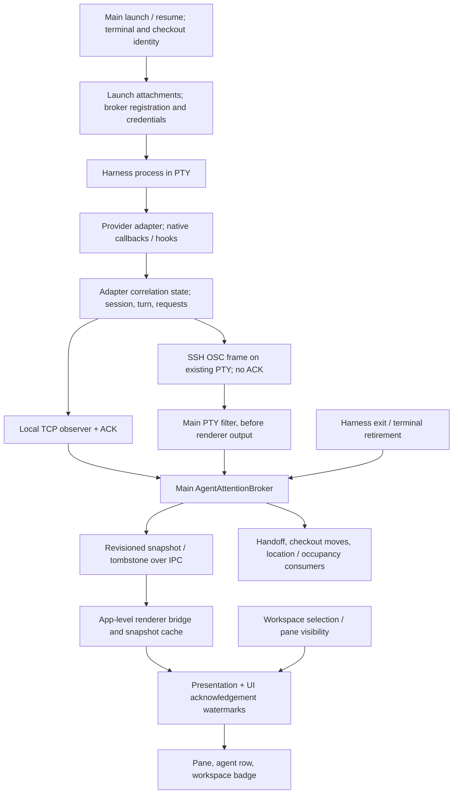

**Independent assessment: Clanker agent attention at `7d17343`**

The central problem is an incomplete observation contract, not a lack of state-machine machinery. Main owns one canonical interpretation, but it cannot establish that its interpretation still matches the harness. Adapters maintain separate correlation state, delivery is best effort, and there is no general recovery protocol. Presentation then conflates acknowledged completion, unverified state, and absent state by drawing nothing.

I reproduced a Pi recovery defect under deliberately withheld boundary delivery and reproduced Codex's `/new` tracking limitation with the installed TUI. Neither establishes the cause of the owner's original incident. Ordinary Pi multi-turn operation and the tested workspace-switching path worked in this investigation. A general claim that workspace switching causes attention loss is unsupported.

The investigation itself made no tracked repository changes, commits, PRs, merges, or issue changes. Builds regenerated ignored build output. This report was subsequently added to the repository at the owner’s request. Experiments used disposable profiles and loopback model fixtures, with no paid inference. Custom experiment scripts and the original assessment were created outside the repository under `/tmp/clanker-attention-investigation-7d17343`; those scratch artifacts are not part of this documentation commit. Prior assessments were not used as technical authority; findings below follow inspected implementation, history, and experiments.

**Scope and evidence**

The checkout was clean at `7d173435d8bc56b02392ffd36b8361f3f28df631`, branch `fix/152-pi-attention-follow-up`. Local main and origin/main both resolved to `f2f40a0`. The follow-up commit changes documentation, test scripts, package scripts, and tests; it changes no `src/` runtime implementation relative to main. Its additional passing evidence cannot itself repair runtime behavior.

Relevant history: `c49d74c` centralized canonical snapshots and removed renderer transition reduction; `2f0e036` strengthened tombstones/hydration; `512c554` replaced unconditional socket acknowledgement with acceptance verdicts; `8f1ea50` introduced acquisition/health reporting; `f9806df`, `e17e1d4`, and `ca5e27b` changed settlement, candidate stops, and subsequent activity recognition. The old listener's `socket.end('ok')` acknowledged receipt independently of acceptance. That particular defect is repaired at the starting revision. The later provisional-stop changes correctly avoid asserting completion from a pre-decision hook, but materially reduce the completion contract available to the product.

Installed versions inspected/run: Pi 1.1.0, Claude Code 2.1.296, Codex CLI 0.162.1, OpenCode 2.0.26; Node 26.11.1 and npm 12.2.0. These results do not certify other versions, Windows, or SSH hosts.

**Current event and ownership architecture**

1. **Launch and identity.** `registerTerminalIpc` prepares local attachments or remote registration before spawning. `attentionLaunchStep` plans provider injection, writes resources, registers a token, and returns disposal. Requested, prepared, and actually observed are distinct facts. Resume paths use the same attachment machinery and can seed a main-validated native root ID. Launch context remains separate from reported location. References: [terminalIpc.ts:184](https://github.com/Bynzski/clanker/blob/7d173435d8bc56b02392ffd36b8361f3f28df631/src/main/ipc/terminalIpc.ts#L184), [attentionLaunchStep:33](https://github.com/Bynzski/clanker/blob/7d173435d8bc56b02392ffd36b8361f3f28df631/src/main/attentionLaunchStep.ts#L33), [trustedRootSessionId:120](https://github.com/Bynzski/clanker/blob/7d173435d8bc56b02392ffd36b8361f3f28df631/src/main/agentAttentionAdapters.ts#L120), [sessionIpc.ts:365](https://github.com/Bynzski/clanker/blob/7d173435d8bc56b02392ffd36b8361f3f28df631/src/main/ipc/sessionIpc.ts#L365).
2. **Native adaptation.** Pi/OMP/OpenCode use in-process plugins with local session/epoch state. Claude/Codex invoke short-lived interpreter processes using shared state files, a directory lock, and a poison marker. Native events are translated to root/session/turn/request envelopes. This is already a second state machine ahead of the broker, even though the broker alone publishes canonical state.
3. **Transport.** Local `OBSERVER.emit` opens one loopback connection per event, waits at most 500 ms, and returns a verdict/boolean. The hook bridge serializes state mutation and delivery, but writes state before delivery. SSH writes bounded base64 OSC frames to `/dev/tty`; successful write is not proof of broker acceptance. `spawnPtyProcess` filters these in main before buffering or forwarding terminal text. Ordinary local PTY output has no lifecycle authority. References: [attentionSources.ts:26](https://github.com/Bynzski/clanker/blob/7d173435d8bc56b02392ffd36b8361f3f28df631/src/main/harnesses/attentionSources.ts#L26), [remoteAttentionTransport.ts:7](https://github.com/Bynzski/clanker/blob/7d173435d8bc56b02392ffd36b8361f3f28df631/src/main/remote/remoteAttentionTransport.ts#L7), [spawnPtyProcess:129](https://github.com/Bynzski/clanker/blob/7d173435d8bc56b02392ffd36b8361f3f28df631/src/main/ipc/ptySpawn.ts#L129).
4. **Canonical interpretation.** Broker authenticates transport/token/harness, validates fields and optional cwd, then correlates root and turn. Its registration owns runtime, active/retired turns, pending requests, historical completion/outcome, location, and signal diagnostics. Revisions order broker publications, not native events. `agent_exited` releases registration; `session_ended` retains registration but clears session and turn state. References: [parse:470](https://github.com/Bynzski/clanker/blob/7d173435d8bc56b02392ffd36b8361f3f28df631/src/main/agentAttentionBroker.ts#L470), [apply:599](https://github.com/Bynzski/clanker/blob/7d173435d8bc56b02392ffd36b8361f3f28df631/src/main/agentAttentionBroker.ts#L599), [settle:766](https://github.com/Bynzski/clanker/blob/7d173435d8bc56b02392ffd36b8361f3f28df631/src/main/agentAttentionBroker.ts#L766).
5. **Renderer and UI.** Main publishes changes independently of selected workspace. `startTerminalSessionBridge` subscribes at app level, then hydrates. The Zustand cache accepts newer revisions; UI watermarks acknowledge requests/completions. `deriveAttention` selects the icon, and workspace badges count only unseen waits/completions. Workspace switching acknowledges newly presented focused panes but does not itself retire the main registration. Cold residency only changes mounted surfaces/runtime residency; it does not remove terminal membership. References: [main.ts:147](https://github.com/Bynzski/clanker/blob/7d173435d8bc56b02392ffd36b8361f3f28df631/src/main/main.ts#L147), [terminalSessionBridge:40](https://github.com/Bynzski/clanker/blob/7d173435d8bc56b02392ffd36b8361f3f28df631/src/renderer/lib/terminalSessionBridge.ts#L40), [withWorkspaceResidency:350](https://github.com/Bynzski/clanker/blob/7d173435d8bc56b02392ffd36b8361f3f28df631/src/renderer/store/workspaceStoreHelpers.ts#L350), [deriveAttention:26](https://github.com/Bynzski/clanker/blob/7d173435d8bc56b02392ffd36b8361f3f28df631/src/renderer/lib/agentAttentionPresentation.ts#L26).
6. **Cleanup.** Harness-wrapper exit sends `agent_exited` before falling back to a shell. PTY exit/explicit retirement disposes attachments and releases broker state; renderer receives tombstones/exit. Workspace close and app teardown kill/dispose owned resources. Removed Codex working directories can invoke `markLifecycleLost`, which clears work/waits, marks unavailable location and lost signal, and retains registration for a later fresh start. References: [harnessLaunch.ts:153](https://github.com/Bynzski/clanker/blob/7d173435d8bc56b02392ffd36b8361f3f28df631/src/main/harnessLaunch.ts#L153), [release:257](https://github.com/Bynzski/clanker/blob/7d173435d8bc56b02392ffd36b8361f3f28df631/src/main/agentAttentionBroker.ts#L257), [markLifecycleLost:422](https://github.com/Bynzski/clanker/blob/7d173435d8bc56b02392ffd36b8361f3f28df631/src/main/agentAttentionBroker.ts#L422), [terminalRetirement.ts:28](https://github.com/Bynzski/clanker/blob/7d173435d8bc56b02392ffd36b8361f3f28df631/src/main/terminalRetirement.ts#L28).

**Findings, ranked by severity and confidence**

**1. High severity, high confidence: losing a Pi reload boundary can suppress subsequent real turns while health remains “observed.” Confirmed by fault injection, not confirmed as the owner's cause.**

Pi's epoch is module-local and resets to zero on extension reload. Its shutdown handler clears local state before sending `session_ended`; the returned delivery result does not gate replacement or trigger replay. Broker clears retired turn IDs only when it accepts a session boundary. A same-session `session_started` is idempotent and does not repair this discrepancy.

I ran real Pi TUI with the normal generated extension and deliberately prevented the first reload's `session_ended` from reaching the broker. After ten successful turns and `/reload`, independent native-event recording showed `session_shutdown`, `session_start`, then a new `agent_start` and `agent_settled`. Broker rejected both turn events as `ignored-stale`, remaining idle at revision 22. The probe failed specifically with “Pi TUI after /reload: no Running publication.”

A separate actual-adapter/real-socket probe completed three turns, lost the reload boundary, and then observed three subsequent starts remain idle/observed at the old revision. The fourth start recovered. Thus this particular collision is not necessarily permanent: recovery depends on the retained epoch IDs. With the preceding epochs 1–32 retained, as many as 32 subsequent turns can be suppressed. This is different from an indefinitely wrong root binding.

References: [Pi SOURCE:14](https://github.com/Bynzski/clanker/blob/7d173435d8bc56b02392ffd36b8361f3f28df631/src/main/harnesses/pi/attention.ts#L14), [shutdown/start handlers:63](https://github.com/Bynzski/clanker/blob/7d173435d8bc56b02392ffd36b8361f3f28df631/src/main/harnesses/pi/attention.ts#L63), [broker session_started:640](https://github.com/Bynzski/clanker/blob/7d173435d8bc56b02392ffd36b8361f3f28df631/src/main/agentAttentionBroker.ts#L640), [retired-turn rejection:673](https://github.com/Bynzski/clanker/blob/7d173435d8bc56b02392ffd36b8361f3f28df631/src/main/agentAttentionBroker.ts#L673), [health handling:547](https://github.com/Bynzski/clanker/blob/7d173435d8bc56b02392ffd36b8361f3f28df631/src/main/agentAttentionBroker.ts#L547). The native fault probe used a temporary copy of `scripts/native-attention-smoke.cjs` and its Pi TUI helper: intercept `broker.receive`, discard only the first `session_ended`, and return `rejected-invalid`; skip the helper’s expected accepted-shutdown ordering assertion so it reaches the first post-reload turn. All other native-turn and Running assertions remain intact. The unmodified smoke passes; this fault variant fails at the post-reload Running publication assertion. This intentionally injected loss does not establish a naturally occurring transport failure.

**2. High severity, high confidence: one-time transitions carry too much recovery responsibility. Confirmed protocol limitation; frequency in ordinary use is unknown.**

There is no sender generation, sequence number, replay buffer, or authoritative state-resync operation. Pi/OpenCode update local state before sending and largely ignore failure; Claude/Codex preserve state plus poison, but poison suppresses some resolutions rather than restoring agreement. The broker cannot detect events that never reach it. Its “observed” health means a qualifying event was accepted, not that the observation channel remains complete.

The socket probe also lost Pi's old-session shutdown while allowing a new native session to start. The adapter moved to B, broker retained A, and every later B turn was rejected. The resulting degraded warning is preferable to silence, but normal prompts do not restore tracking. If a native session ID changes without the adapter seeing shutdown at all, Pi's root guard emits nothing for the new ID. That latter sequence was simulated, not observed in the installed native smoke.

Merely losing a completion ACK is **not** the claimed permanent-epoch failure: Pi clears `open` before awaiting completion delivery. The next actual start advances its epoch. The follow-up tests correctly exercise this distinction. Conversely, a missing native settlement callback leaves `open` true, but by itself does not prove the broker already retired that turn; those are different failure assumptions.

References: [OBSERVER](https://github.com/Bynzski/clanker/blob/7d173435d8bc56b02392ffd36b8361f3f28df631/src/main/harnesses/attentionSources.ts#L26), [bridge delivery/poison logic:211](https://github.com/Bynzski/clanker/blob/7d173435d8bc56b02392ffd36b8361f3f28df631/src/main/harnesses/attentionSources.ts#L211), [Pi agent_settled:55](https://github.com/Bynzski/clanker/blob/7d173435d8bc56b02392ffd36b8361f3f28df631/src/main/harnesses/pi/attention.ts#L55), [OpenCode handle:85](https://github.com/Bynzski/clanker/blob/7d173435d8bc56b02392ffd36b8361f3f28df631/src/main/harnesses/opencode/attention.ts#L85), [SSH observer:46](https://github.com/Bynzski/clanker/blob/7d173435d8bc56b02392ffd36b8361f3f28df631/src/main/remote/remoteAttentionTransport.ts#L46).

**3. High severity, high confidence: native session selection is not consistently represented. Codex failure reproduced; OpenCode implications remain partly unverified.**

Installed Codex `/new` emits startup rather than the explicit `source=clear` transition recognized by the adapter. The old root stays bound and subsequent prompts are rejected. The existing native TUI smoke reproduced this and passed because it asserts the limitation. This is safe identity rejection, but it does not meet the user's expectation that an agent remains tracked through a normal new-session operation.

OpenCode establishes parentless/root session identity, not which root conversation the terminal currently presents. Only deletion produces its `session_ended`; creating/selecting another surviving root has no explicit selection transition in the adapter. Automatically accepting every parentless session would be wrong for server/multi-session operation. An authoritative selected-conversation binding is needed. I did not validate the installed OpenCode TUI switching behavior: its existing server smoke failed earlier with HTTP 405 on POST `/session`.

References: [Codex SessionStart:69](https://github.com/Bynzski/clanker/blob/7d173435d8bc56b02392ffd36b8361f3f28df631/src/main/harnesses/codex/attention.ts#L69), [broker mismatch gate:635](https://github.com/Bynzski/clanker/blob/7d173435d8bc56b02392ffd36b8361f3f28df631/src/main/agentAttentionBroker.ts#L635), [Codex smoke:81](https://github.com/Bynzski/clanker/blob/7d173435d8bc56b02392ffd36b8361f3f28df631/scripts/codex-attention-tui-smoke.cjs#L81), [OpenCode classify:43](https://github.com/Bynzski/clanker/blob/7d173435d8bc56b02392ffd36b8361f3f28df631/src/main/harnesses/opencode/attention.ts#L43).

**4. Medium severity, high confidence: the presentation contract deliberately hides truthful states and makes several failures look alike. Confirmed behavior.**

A focused terminal's completion is acknowledged during `applyChange`, before presentation. `deriveAttention` shows completion only if unseen, so Working → nothing is the expected successful foreground path. Prepared-but-unverified, acknowledged idle, interrupted idle, and missing snapshot can all be blank. There is no ordinary explicit Unknown state. Existing warning states only cover unavailable/degraded/lost signals. A properly delivered later fresh start still shows Running; acknowledgement alone cannot explain permanent disappearance.

“Finished” should be persistent current state, independently of whether its notification has been read. “Unknown” should be visible for enabled agent integrations that have insufficient current evidence. Do not repair this with a brief completion timer; that still confuses notification lifetime with lifecycle truth. Foreground acknowledgement also does not check OS-window focus, so an active pane in an unfocused app can have completions considered seen.

References: [merge:74](https://github.com/Bynzski/clanker/blob/7d173435d8bc56b02392ffd36b8361f3f28df631/src/renderer/store/agentAttentionStore.ts#L74), [isForeground:41](https://github.com/Bynzski/clanker/blob/7d173435d8bc56b02392ffd36b8361f3f28df631/src/renderer/lib/terminalSessionBridge.ts#L41), [deriveAttention:31](https://github.com/Bynzski/clanker/blob/7d173435d8bc56b02392ffd36b8361f3f28df631/src/renderer/lib/agentAttentionPresentation.ts#L31).

**5. Medium severity, high confidence: Claude and Codex cannot currently prove ordinary successful completion through these adapters. Confirmed limitation, not justification to guess.**

Both map Stop to provisional because another Stop hook may continue execution. Neither adapter emits `turn_completed` for a normal root Stop. Native Claude smoke observed ten turns and a real post-Stop Read continuation; state correctly returned to Running for that same turn, then provisional. It did not observe StopFailure within its five-second error window. Codex TUI likewise ended ordinary turns provisionally.

The user-facing “Finished” requirement is therefore unavailable for ordinary successful Claude/Codex turns through this path. The consequence extends beyond icons: `handoffState` refuses provisional state; scheduled after-turn checkout moves cancel on provisional Stop. These consumers need explicit capabilities indicating whether final settlement is provable, rather than equating installed hooks with support for every lifecycle-dependent feature.

References: [Claude Stop:80](https://github.com/Bynzski/clanker/blob/7d173435d8bc56b02392ffd36b8361f3f28df631/src/main/harnesses/claude/attention.ts#L80), [Codex Stop:111](https://github.com/Bynzski/clanker/blob/7d173435d8bc56b02392ffd36b8361f3f28df631/src/main/harnesses/codex/attention.ts#L111), [handoffState:393](https://github.com/Bynzski/clanker/blob/7d173435d8bc56b02392ffd36b8361f3f28df631/src/main/agentAttentionBroker.ts#L393), [onAttentionChange:243](https://github.com/Bynzski/clanker/blob/7d173435d8bc56b02392ffd36b8361f3f28df631/src/main/isolatedCheckout/isolatedCheckoutService.ts#L243).

**6. Medium severity, medium confidence as a field mechanism: renderer-local retirement can disagree with live main state. Conditional mechanism confirmed by code; ordinary switching did not reproduce it.**

The app bridge retires cached attention when a terminal disappears from renderer workspace membership. That creates a tombstone at the currently known revision. Equal-revision live hydration cannot override it. If membership disappears transiently while the main terminal remains alive, a rehydration of unchanged main state cannot restore the cache. A later higher-revision publication can recover it, so this alone is not proof of permanent loss.

This is an authority leak: removing something from a UI collection is not necessarily proof of process retirement. However, cold workspace residency preserves terminal collections, and the real Electron smoke passed cold unmount/remount, four workspaces, minimization, hidden pages, and subsequent turns. I found no evidence that simple workspace selection executes the hypothesized transient-removal sequence.

References: [membership retirement:71](https://github.com/Bynzski/clanker/blob/7d173435d8bc56b02392ffd36b8361f3f28df631/src/renderer/lib/terminalSessionBridge.ts#L71), [equal-revision dominance:56](https://github.com/Bynzski/clanker/blob/7d173435d8bc56b02392ffd36b8361f3f28df631/src/renderer/store/agentAttentionStore.ts#L56), [retire:111](https://github.com/Bynzski/clanker/blob/7d173435d8bc56b02392ffd36b8361f3f28df631/src/renderer/store/agentAttentionStore.ts#L111).

**7. Medium severity, high confidence: passing tests do not establish the missing upstream contracts. Confirmed evidence gap.**

The tests are useful and include real sockets, subprocesses, PTYs, and Electron. They are not merely mocks. But their boundaries matter:

- Provider unit tests call fabricated callbacks with expected fields; their observer often always returns true.
- Pi/OpenCode “late settle cannot close turn 2” tests replay an already translated envelope carrying turn 1. They do not inject a late native unnumbered settlement callback after turn 2 starts. Such a callback would acquire the adapter's current epoch. Upstream ordering may prevent this, but the test does not establish that ordering.
- Native Pi smoke uses an isolated profile, disables ordinary extensions/skills and retry/compaction, and omits mounted Clanker renderer. Resume/fork use extension API commands rather than actual picker interaction.
- Electron smoke uses a fake Pi executable emitting canonical lifecycle events. It bypasses real native adapter behavior.
- Codex smoke passes while explicitly asserting `/new` rejection. Claude smoke passes without observing definitive completion or timely failure.
- SSH tests exercise preparation, authentication, generated code and PTY framing; they are not field proof for every host/harness/network combination.
- `npm run validate` does not invoke the separately named native/Electron smoke scripts.
- OpenCode 2.0.26 returned HTTP 405 at the existing smoke's first POST `/session`, before any fixture model request. This does not prove its attention plugin fails, but the smoke cannot certify this installed version.

References: [provider fixture observer:48](https://github.com/Bynzski/clanker/blob/7d173435d8bc56b02392ffd36b8361f3f28df631/tests/main/unit/attentionProviderLifecycle.test.ts#L48), [Pi late-wire test:650](https://github.com/Bynzski/clanker/blob/7d173435d8bc56b02392ffd36b8361f3f28df631/tests/main/unit/attentionProviderLifecycle.test.ts#L650), [OpenCode late-wire test:1023](https://github.com/Bynzski/clanker/blob/7d173435d8bc56b02392ffd36b8361f3f28df631/tests/main/unit/attentionProviderLifecycle.test.ts#L1023), [Pi TUI fixture](https://github.com/Bynzski/clanker/blob/7d173435d8bc56b02392ffd36b8361f3f28df631/scripts/lib/pi-attention-tui-smoke.cjs#L1), [Electron fixture](https://github.com/Bynzski/clanker/blob/7d173435d8bc56b02392ffd36b8361f3f28df631/scripts/attention-electron-smoke.cjs#L1).

**Harness-specific assessment**

| Harness/surface | Strongest implemented evidence | Material limits |
|---|---|---|
| Pi local | Native agent_start / agent_settled; extension UI prompt brackets | Local epoch resets; session-boundary delivery dependency; not every built-in dialog covered. Installed ordinary TUI sequence passed. |
| Claude local | prompt_id root hooks; PermissionRequest / AskUserQuestion; PostToolBatch | No final post-decision completion; no interrupt hook in adapter; approval stays pending until batch completes; version/field assumptions. Stream-json smoke passed its limited contract. |
| Codex local | Native session/turn IDs, root hooks, Interrupt | Candidate Stop only; `/new` mismatch reproduced; hooks/trust/profile conflicts; removed-cwd hook failure; fingerprint-based approval correlation. |
| OpenCode local | Native busy/idle, parentage lookup, explicit request/reply IDs | No terminal-selected-session contract; synthetic turn epochs; async metadata queue can delay all later events without an explicit adapter timeout. Installed server smoke incompatible before lifecycle exercise. |
| Hermes local CLI / Assistant | No local CLI attention adapter; Assistant is a separate service-backed surface | Must show unavailable/unknown where agent status is requested; Assistant state is not ordinary terminal attention. |
| Hermes SSH | pre_llm_call, final on_session_end outcome flags, approval hooks, compression lineage | Remote only; Python/private-runtime/SQLite lineage dependency; bounded lineage lookup; no real-host run in this investigation. |
| SSH generally | Same provider semantics over authenticated terminal-bound OSC | No end-to-end ACK/replay; nonblocking tty writes may fail; framing corruption/partial delivery may be discarded; no current remote state query. Host version/runtime/configuration matters. |
| Generic shell/process | PTY exists/exits | No truthful agent Working/Needs attention/Finished semantics. Shell output or quietness cannot supply them. A manually launched CLI is not automatically a registered integration. |
| OMP / Antigravity | Provider-specific finality/control fields | OMP uses post-control agent_end and synthetic epochs; Antigravity depends on explicit completion/cancellation fields. Neither was independently live-tested here. |

**Is this overengineered?**

Partly. The valuable core is small: launch ownership, authenticated provider events, one main reducer, revisioned snapshots, and pure UI projection. Keep it. Renderer cache and notification watermarks are legitimate separate state, not inherently harmful duplication.

The excessive complexity is concentrated in compensating for incomplete native contracts: parallel-tool input fingerprints, bounded call/done/wait ledgers, file locks, poison state, root lineage reconstruction, and alternate fallback authority with no production producer. These mechanisms can make conservative decisions; they cannot create missing knowledge. The current `full`/`partial` vocabulary is too coarse: Codex defaults to full while normal completion and `/new` coverage are incomplete. The unused fallback arbitration should not drive architecture before a trustworthy source exists.

Location/checkout evidence is also coupled to lifecycle acceptance: `parse` rejects an entire event when an included cwd cannot be resolved, despite location being descriptive. Separate acceptance of lifecycle identity from acceptance of location metadata; invalid location should never grant authority, but need not discard an otherwise valid completion. This is a code-confirmed coupling, not an observed owner failure.

**Proposed minimal robust architecture**

Keep main as the only application authority, but make it explicitly a projection of a verified native observer, not an oracle. A small record should contain launch identity, selected native session, observer generation/sequence, current state, evidence/reason, last known outcome, and observation coverage/health. UI unread state stays separate.

Use four primary user states: Working, Needs attention, Finished, Unknown. An outcome detail can distinguish successful, interrupted, and failed endings. Keep explicit non-agent/disabled/unavailable eligibility separate. “Finished” must not mean success unless success was proved. A candidate Stop is Unknown with “stop observed; finality unverified.”

A provider adapter needs a narrow capability contract: can identify selected root; can prove turn start; can prove blocking human request; can prove request resolution; can prove final settlement; can recover/requery after an observation gap. Version/contract verification belongs here. Native request IDs and final outcome events should be preferred to fingerprints and screen interpretation.

For in-process adapters such as Pi, send a bounded current-state snapshot at native boundaries, with an observer-instance ID and monotonically increasing sequence. Distinguish session replacement from observer reload. Broker must authorize the replacement generation using a launch-scoped handshake or explicit transition and fence old generations; a random new epoch accepted indiscriminately would weaken stale-event protection. A same-session reload needs its own recovery path rather than depending exclusively on successful delivery from the outgoing module. A snapshot must identify which fields the adapter actually knows, not fabricate idle/completion on startup.

Use ordered bounded retry/replay locally, with ACK meaning broker application. Resolve uncertain delivery by resending idempotent numbered state, not synthesizing new turns. Do not stall provider execution indefinitely. SSH can retain the PTY transport initially, but periodically resend a bounded authoritative adapter snapshot/heartbeat or support explicit resync. Heartbeat loss may justify Unknown; it never means Finished, and heartbeat receipt alone never means Working. No need to add a daemon solely for status before demonstrating that need.

Claude/Codex short-lived hooks cannot produce a full authoritative status query just by keeping a file. Until a supported native post-decision/status channel exists, advertise partial coverage and report Unknown at the gaps. Using a native RPC/app-server lifecycle could be an explicit integration mode, but requires proving it tracks the same visible conversation and does not alter launch ownership. Do not silently replace the user's TUI architecture to obtain a nicer icon.

Renderer should cache broker snapshots and only derive display/unread badges. Keep authoritative tombstones tied to main retirement; UI collection removal should detach presentation without forbidding a still-live authoritative snapshot. Workspace switching should not reconnect lifecycle acquisition or mutate native state.

**Focused reproduction and instrumentation**

First capture the failure at a single end-to-end boundary trace, not another wide collection of state-machine cases. Use the existing `CLANKER_DEBUG_ATTENTION=1` and `window.clankerAttention.explain(terminalId)` as a starting point, but add a bounded per-launch ring covering native callback, adapter decision, send attempt/result, broker verdict/revision, IPC publication, renderer merge decision/revision, presentation, and retirement reason. Include monotonic timestamps and opaque/hash identities for session, turn, observer generation, and request; exclude tokens, prompts, responses, tool arguments, and raw paths. Capture version, mode, attachment outcome, and workspace/pane identity. Record reasons for silent adapter returns as well as broker rejections.

Current diagnostics cannot explain an event never emitted by the adapter, do not trace sender receipt/ACK comprehensively, and lose registration counters on release. A query of main followed by renderer is also not an atomic snapshot, so compare revisions carefully.

Run the real Pi TUI inside the actual Clanker Electron launch path, with loopback model fixtures and visible DOM assertions. Exercise 50+ turns, tool execution, waits, abort/error/retry, reload, new/resume/fork/tree navigation, and four-workspace cold switching. Add the owner's extensions one at a time only after the isolated sequence is stable. Test foreground versus background and OS-window focus separately.

Faults should target one link at a time: lose only ACK; lose completion envelope; lose session shutdown before same-session reload; lose shutdown before new session; delay native callback versus delay already translated wire event; temporarily block the broker event loop past 500 ms; lose renderer subscription/hydration; interrupt SSH frame delivery. Assert both truthful state during the gap and recovery afterward. Existing tests cover only parts of this matrix.

For the disappearance case, inspect in this order: registration still exists? adapter emitted native start? delivery accepted? root/turn/generation rejected? broker revision changed? renderer applied that revision? icon suppressed by acknowledgement/eligibility? This distinguishes an intended blank completion from loss of acquisition, loss of correlation, stale cache, or presentation suppression.

**Recommended correction sequence**

1. Smallest viable product change: separate persistent lifecycle display from unread acknowledgement, and render explicit Unknown for enabled/unverified or absent lifecycle evidence. Add bounded loss-stage diagnostics. This improves truthfulness immediately but does not fix transport recovery.
2. Smallest demonstrated reliability correction: address Pi observer reload identity and recovery of a missing outgoing boundary. Add a regression based on the reproduced native TUI loss sequence, not just completion-ACK loss. Use explicit generation fencing/resync; do not accept arbitrary session IDs because cwd matches and do not increment a new turn on every duplicate callback.
3. Establish explicit selected-session transitions for Codex `/new` and OpenCode switching, backed by native contract evidence. If unavailable, surface the limitation and require an explicit fresh integration launch; never silently retain a healthy-looking old session.
4. Add numbered state delivery/replay or authoritative resync to the shared adapter contract, with bounded failure-to-Unknown behavior. Reuse it across local and SSH transports rather than adding more harness-specific recovery flags.
5. Advertise settlement and request-resolution capabilities separately; gate handoff/after-turn operations accordingly. Preserve conservative cancellation where finality is unproved.
6. Remove unused fallback machinery and duplicated health/eligibility projections only after the minimal contract is established. Retain regression protections for root attribution, stale generations, pending waits, and cleanup. Make versioned real-native-plus-Electron fixtures a separate integration gate; retain fast unit tests for reducers and security boundaries.

Unknown is the correct answer when the adapter has not verified its contract, the selected session is unproven, observation continuity is broken, a candidate Stop has no final decision, a request's resolution is unobservable, the harness uses an unsupported mode/version, or a generic terminal supplies no native lifecycle. Quiet PTY output, elapsed time, a process being alive, a model's final text, and focus changes cannot prove completion.

**Validation results**

- `npm run build`: passed.
- `npm run smoke:attention:pi-tui`: passed on Pi 1.1.0; ten consecutive turns plus reload/new/resume/fork/wait/error/interrupt sequences.
- `npm run smoke:attention:electron`: passed for synthetic lifecycle events across real Electron/PTY/IPC/React, including cold workspaces and restart.
- `npm run smoke:attention:codex-tui`: passed its assertions on Codex 0.162.1, including the explicitly expected `/new` degradation.
- `npm run smoke:attention:claude`: passed its limited stream-json contract on Claude 2.1.296; normal turns remain provisional, and the fixture did not observe StopFailure within five seconds.
- `npm run smoke:attention:opencode`: failed before inference at POST `/session`, HTTP 405 on OpenCode 2.0.26; diagnostic rerun confirmed this. No claim of live OpenCode lifecycle verification.
- Custom Pi fault probes: reproduced stale epochs after lost reload boundary, rejected new-session events after lost shutdown, and silent guard behavior for a simulated unexplained native ID change. Real native TUI loss probe failed as expected on the first post-reload Running assertion.
- Required final `npm run validate`: passed branding, lint, typecheck, Fallow, security audit, build, and all 7,922 tests in 391 files. The full console log was retained in the investigation’s scratch directory as `validate.log`. Final `git status --short` was empty before publishing this report.

The owner-observed incident remains unresolved without a trace of its actual failing sequence. The investigation establishes a concrete recovery defect and several contract/product gaps; it does not support declaring one universal cause across Pi, Claude, Codex, and workspace switching.
